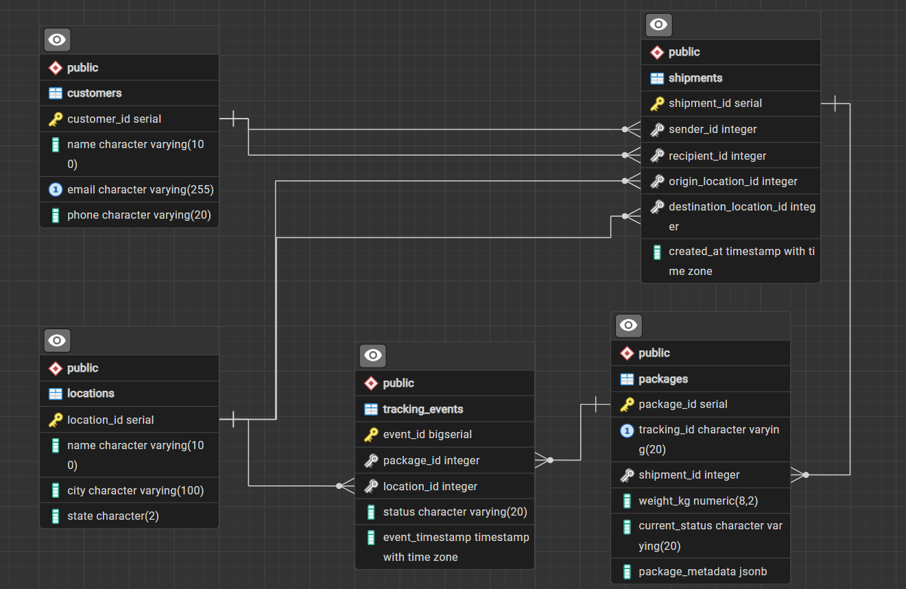

# Logistics and Shipment Tracking Backend

Backend data service for a shipment tracking company. Warehouse and driver scans
are processed in Python and stored across three databases:

- **PostgreSQL** – normalized core data (customers, locations, shipments, packages, tracking events)
- **Redis** – latest status of each package for fast lookups
- **MongoDB** – raw scanner event logs for auditing

## Project Structure

```
├── docker-compose.yml     # PostgreSQL, Redis and MongoDB containers
├── requirements.txt
├── app/
│   └── tracking.py        # connection pool, scan processing, status cache, history query
├── sql/
│   ├── schema.sql         # DDL (tables, constraints, composite index)
│   ├── seed.sql           # sample data (~100k tracking events)
│   └── benchmark.sql      # EXPLAIN ANALYZE before/after the composite index
├── tests/
│   └── test_tracking.py
└── docs/
    └── er_diagram.png
```

## Setup

Requirements: Docker and Python 3.11+.

1. Start the databases:

   ```
   docker compose up -d
   ```

   The containers use non-default host ports so they don't clash with other local installs:

   | Service    | Host port | Credentials                                    |
   |------------|-----------|------------------------------------------------|
   | PostgreSQL | 5434      | database, user and password: `logistics`       |
   | Redis      | 6380      | none                                           |
   | MongoDB    | 27018     | none (database `logistics`, collection `scan_logs`) |

2. Create the schema and load the sample data, either by running `sql/schema.sql` and then
   `sql/seed.sql` in pgAdmin's Query Tool, or from the command line:

   ```
   docker compose exec -T postgres psql -U logistics -d logistics < sql/schema.sql
   docker compose exec -T postgres psql -U logistics -d logistics < sql/seed.sql
   ```

   (In PowerShell, which has no `<` redirection, use
   `Get-Content sql/schema.sql | docker compose exec -T postgres psql -U logistics -d logistics`.)

3. Install the Python dependencies:

   ```
   python -m venv .venv
   .venv\Scripts\activate        # Windows (macOS/Linux: source .venv/bin/activate)
   pip install -r requirements.txt
   ```

4. Run the tests (they need the containers running and the seed data loaded):

   ```
   python -m pytest -v
   ```

## Usage

From the project root, in a Python shell:

```python
from app.tracking import process_tracking_scan, get_package_status, get_package_history

process_tracking_scan(5, 4, "Picked Up", "CHI-SCANNER-01")   # package_id, location_id, status, scanner_id
get_package_status("TRK00000005")    # {'status': 'Picked Up', 'location': 'Chicago, IL'}
get_package_history("TRK00000005")   # list of (event_timestamp, status, location, time_since_previous)
```

## ER Diagram



## Schema Explanation

| Table             | Purpose                                                            | Key relationships |
|-------------------|--------------------------------------------------------------------|-------------------|
| `customers`       | People who send or receive shipments                               | – |
| `locations`       | Warehouses and hubs where scans happen (name, city, state)         | – |
| `shipments`       | One order sent from a sender to a recipient                        | `sender_id`, `recipient_id` → `customers`; `origin_location_id`, `destination_location_id` → `locations` |
| `packages`        | Physical parcels in a shipment, identified publicly by `tracking_id` | `shipment_id` → `shipments` (one shipment has many packages) |
| `tracking_events` | One row per scan: which package, where, what status, when          | `package_id` → `packages`; `location_id` → `locations` |

**Normalization (3NF).** Every table has a single-column primary key and each non-key column
depends only on that key. Customer and location details are stored once and referenced by
foreign keys, so a city name or email is never repeated across shipments or events.

The one deliberate exception is `packages.current_status`, which duplicates the status of
the latest tracking event. The project requires it so the current status can be read
without scanning the event history, and `process_tracking_scan` keeps the two in sync by
updating both in the same transaction.

**Constraints.**

- Primary keys on every table; `customers.email` and `packages.tracking_id` are `UNIQUE`.
- Foreign keys for every relationship above.
- `CHECK` constraints limit `current_status` and `tracking_events.status` to
  `Created`, `Picked Up`, `In Transit`, `Out for Delivery`, `Delivered`, `Exception`,
  and require `weight_kg > 0`.
- `package_metadata` is a `JSONB` column for flexible package attributes such as
  `{"fragile": true, "requires_signature": false}`.
- Composite index `idx_tracking_events_package_time` on `tracking_events (package_id, event_timestamp)`.

## How a Scan Is Processed

`process_tracking_scan(package_id, location_id, status, scanner_id)` in `app/tracking.py`:

1. Takes a connection from the psycopg2 connection pool.
2. In **one transaction**, updates `packages.current_status` and inserts a row into
   `tracking_events`. If either statement fails, both are rolled back. All queries use
   parameterized placeholders (`%s`), never string formatting.
3. Logs the raw scan to MongoDB (`scan_logs`) with the scanner ID, timestamp and scan
   details. Failed scans are logged too, with `result: "failed"` and the error message, so
   the audit trail contains every scan.
4. After a successful commit, caches the latest status in Redis:

   ```
   key:   package:<tracking_id>:status
   value: {"status": "In Transit", "location": "City, ST"}
   ```

`get_package_status(tracking_id)` reads from Redis first. On a cache miss it reads the
latest status from PostgreSQL and stores it in Redis (cache-aside).

## Tracking History Query

`get_package_history(tracking_id)` rebuilds a package's full history. A CTE collects the
package's events with their locations, and `LAG()` computes the time since the previous
event:

```sql
WITH package_events AS (
    SELECT e.event_timestamp, e.status, l.city || ', ' || l.state AS location
    FROM tracking_events e
    JOIN packages p ON p.package_id = e.package_id
    JOIN locations l ON l.location_id = e.location_id
    WHERE p.tracking_id = %s
)
SELECT event_timestamp,
       status,
       location,
       event_timestamp - LAG(event_timestamp) OVER (ORDER BY event_timestamp) AS time_since_previous
FROM package_events
ORDER BY event_timestamp;
```

Example result for a package after four scans:

```
event_timestamp      status            location         time_since_previous
2026-09-01 00:06:00  Created           Chicago, IL
2026-11-01 23:58:04  Picked Up         Chicago, IL      61 days, 23:52:04.333002
2026-11-01 23:58:04  In Transit        Los Angeles, CA  0:00:00.053038
2026-11-01 23:58:04  Out for Delivery  New York, NY     0:00:00.005607
2026-11-01 23:58:04  Delivered         New York, NY     0:00:00.005292
```

The last four scans ran back to back, so the gaps between them are fractions of a second.
